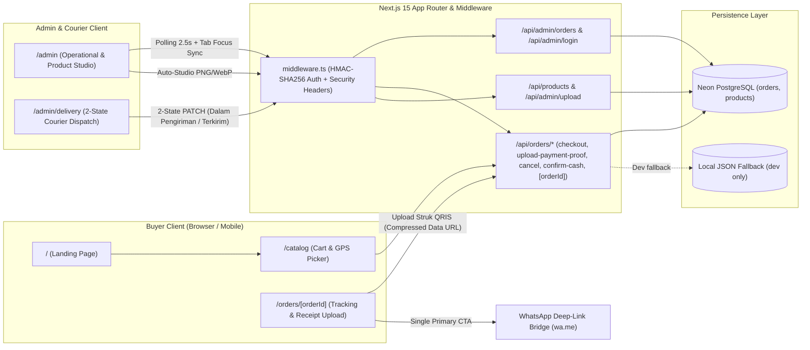
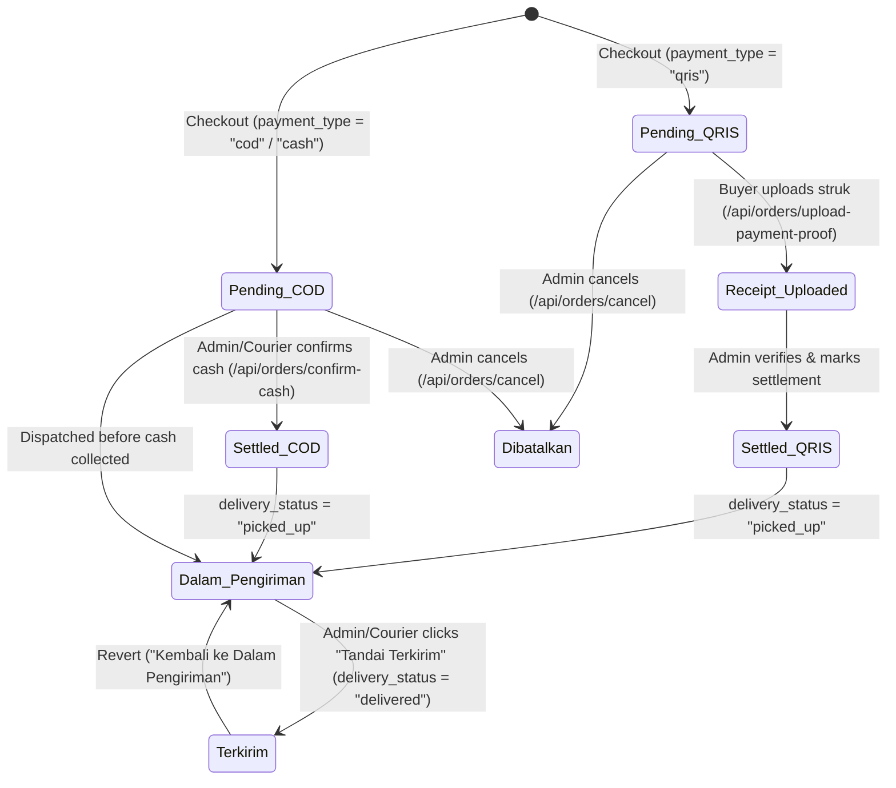

# Architecture — D'Oleh-Oleh Dieng (`KARIKA-DIENG-UI`)

Dokumen ini menjelaskan arsitektur sistem, aliran data pembayaran & pesanan, mekanisme sinkronisasi bukti transfer, serta pipeline pemrosesan gambar produk berbasis WebAssembly di browser.

---

## 1. High-Level System Architecture

---

## 2. Routing & Hierarki Komponen Frontend

- **`app/page.tsx`**: Landing page dengan Hero Card logo resmi, etalase 9 produk unggulan (grid 3x3), banner pesanan aktif dari `localStorage`, dan footer informasi toko.
- **`app/catalog/page.tsx`**: Katalog lengkap, filter kategori, pencarian, manajemen keranjang (`localStorage`), validasi minimal 5 paket, `DeliveryLocationPicker` (kalkulasi jarak Haversine maks. 8 km), dan checkout (`qris` / `cod`).
- **`app/orders/[orderId]/page.tsx`**: Halaman detail pesanan pembeli dengan polling 2 detik:
  - Menampilkan QRIS dinamis/statis toko dan form upload struk **hanya untuk metode QRIS**.
  - Menampilkan panel konfirmasi tunai yang ringkas **untuk metode COD (`cod`/`cash`)**.
  - Menyediakan **satu tombol utama WhatsApp** di bagian bawah halaman.
- **`app/admin/page.tsx`**: Dashboard operasional admin (dilindungi middleware cookie HMAC-SHA256), memakai `useKitchenOrders()` dengan polling 2,5 detik + event `focus` & `visibilitychange`. Mengelola pesanan, lightbox bukti transfer pembeli, pengaturan QRIS/WA, serta CRUD produk & **Auto-Studio**.
- **`app/admin/delivery/page.tsx`**: Halaman khusus pengantaran kurir dengan kartu berdensitas ringkas dan kontrol 2 status pengiriman.

---

## 3. Payment & Order State Machine

### Sinkronisasi Bukti Transfer QRIS (`/orders/[orderId]` &rarr; `/admin`)
1. Pembeli memilih file gambar struk pada `Form Upload Bukti Struk Transfer Pembeli`.
2. Client mengompresi gambar ke JPEG (`maxDim: 1200px`, kualitas `0.82`) agar cepat diunggah pada jaringan dataran tinggi dan aman terhadap batas payload serverless.
3. `POST /api/orders/upload-payment-proof` menyimpan Data URL langsung ke kolom `payment_proof_url` dan `payment_proof_uploaded_at` pada tabel `orders` di Neon PostgreSQL via `updateOrderPaymentProof()`.
4. `getAllOrdersAdmin()` dan `getOrderById()` menggunakan helper `mapNeonRowToOrder()` yang memetakan `payment_proof_url` dan `payment_proof_uploaded_at` secara utuh, sehingga kartu pesanan di `/admin` langsung menampilkan tombol **`Lihat Bukti Transfer Pembeli`** tanpa perlu scan barcode.

---

## 4. Client-Side WASM Background Removal & Canvas Template Pipeline

Pipeline di `lib/product-studio.ts` berjalan **100% di sisi client (browser)** tanpa biaya API eksternal:

1. **Input**: Admin memilih file mentah (`JPG`/`PNG`/`WEBP`, maks. 5 MB) di modal Tambah/Edit Produk (`/admin`).
2. **Background Removal (`removeProductBackground`)**:
   - Memuat `@imgly/background-removal` secara dinamis (*lazy import*) dengan progress callback.
   - Menghasilkan cutout transparan, lalu memindai bounding box piksel non-transparan (`alpha > 12`) untuk memotong margin kosong (*auto-trim*) dan menempatkan objek di tengah kanvas `800×800` pada skala `~78%`.
3. **Compositor (`renderStudioProductImage`)**:
   - Mode **`Transparan Murni (PNG)`**: Mengekspor PNG transparan `800×800`.
   - Mode **`Template Katalog D'Oleh-Oleh`**: Menggambar latar hangat gradasi `#FAF8F3` &rarr; `#EAE4D7`, aksen garis hijau-amber khas Dieng, bayangan elips kontak di bawah produk, badge merek `D'OLEH-OLEH`, dan badge kemasan opsional (`packBadge`), lalu mengekspor sebagai `WebP` teroptimasi.
4. **Upload**: Pada environment produksi Vercel (filesystem ephemeral), `/api/admin/upload` mengembalikan Data URL hasil optimasi untuk disimpan permanen di kolom `products.image` Neon DB.
